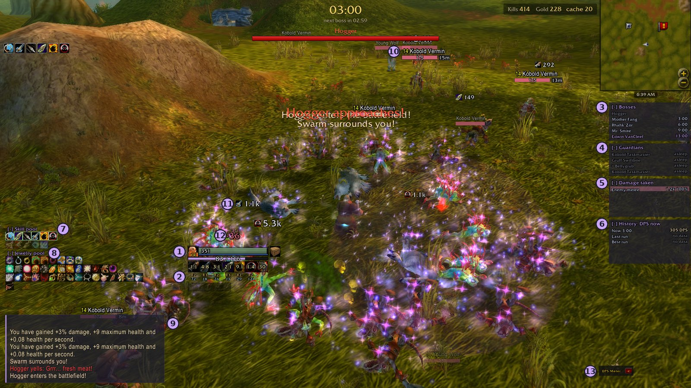
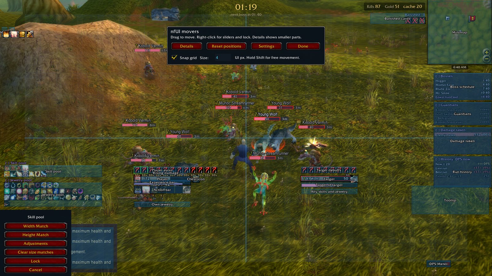
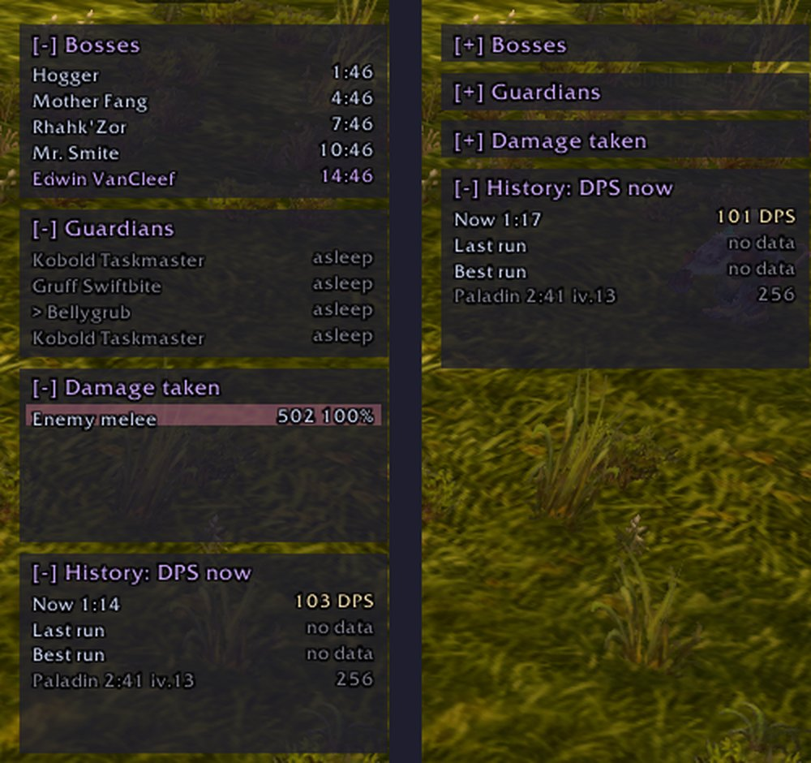
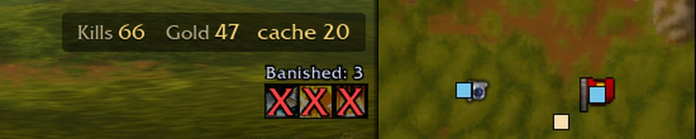
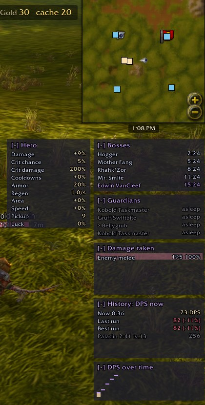
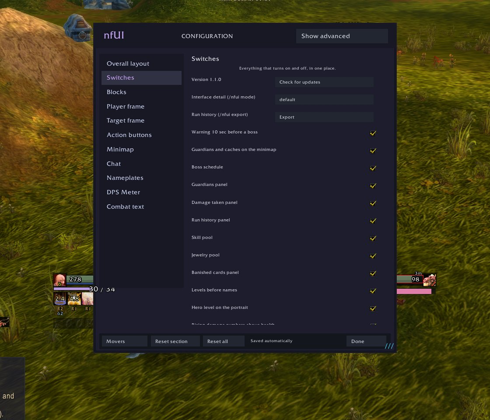
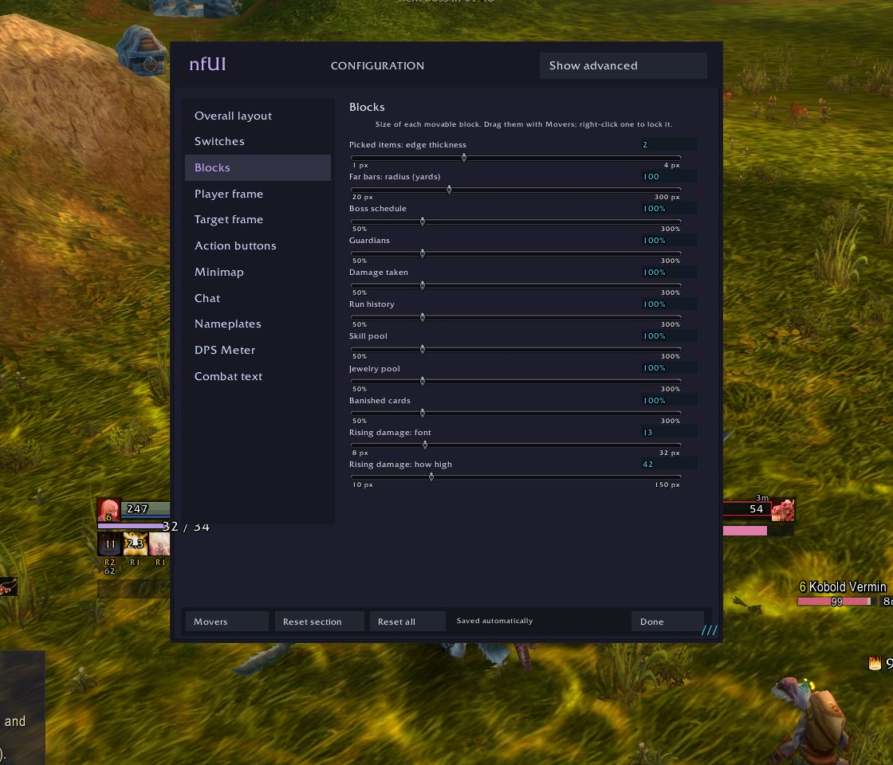
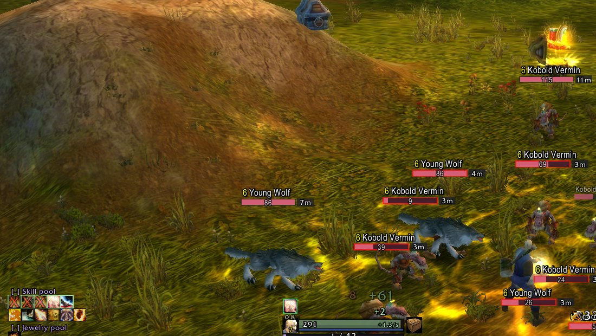

# nfUI Survivors Edit

**A readable HUD for Azeroth Survivors: see what is hitting you, what your run is worth and what can still come up, even in a swarm.**

An unofficial edit of [nfUI](https://github.com/nfmous/nfui_AZSRV) by nfmous. Everything can be moved, resized, folded and switched off.

[Русская версия](README.ru.md) · [What's new](../CHANGELOG.md) · [Original nfUI readme](ORIGINAL-README.md)

## What is on the screen

| # | Part | What it does |
|---|---|---|
| 1 | Hero frame | Current health as a number, regeneration per second at the bar's end, level on the portrait, shield amount, a chest icon when you can afford one. A red line marks the biggest hit of the last minute: when health and shield fall under it, the bar pulses and says the next such hit kills |
| 2 | Skill bar | Cooldown numbers on every skill, with rank and DPS under each. Hover a skill for its DPS, share of damage and damage this run |
| 3 | Bosses | Countdown to every boss of the run: yellow under 30 sec, red under 10, the final boss in violet |
| 4 | Guardians | Each lair: countdown until its guardian appears, then asleep or its health. The `>` marks the one the game points at |
| 5 | Damage taken | What has hurt you this run: enemy or boss, melee, spell or area, with shares |
| 6 | History | Your DPS now against your last and best run with the same class in the same zone and difficulty, and the class's best anywhere, **at the same moment of the run**. Below, the class's latest runs on any map |
| 7 | Skill pool | Picked skills on their own row with a green edge, what can still come up below. Dims when all 6 are picked |
| 8 | Jewelry pool | A row for each kind, same order of effects: damage, survival, utility. Worn pieces have a green edge. On top, larger, the legendary amulets of the spells you have, each with its spell in the corner as in the Codex. Rings and trinkets dim once both slots are full, other amulets once one is worn. Hover to read them |
| 9 | Chat | A clear narrow font, even margins, tabs always visible, the input box above it |
| 10 | Enemy bars | Level coloured as in classic WoW (grey, green, yellow, orange, red), current health, distance in metres, a red edge on enemies next to you. Mobs, elites, guardians and bosses differ in size, mark and edge colour; allies get an edge in their class colour, the party's pets a thin bar without a name. Health drains smoothly and leaves a trail. Pale bars are enemies beyond the game's own nameplates |
| 11 | Damage numbers | Your hits, also above the target's health with the skill's icon. Bigger hits are larger and stay longer. Hits that cannot be placed merge into one number instead of a pile |
| 12 | Damage and healing on you | Slow columns rising above your health and dissolving: red for damage, green for active healing beside it; bigger numbers are larger |
| 13 | DPS meter | Click to expand: every skill with its icon, hits per second and its biggest hit, and the party's in co-op |

Also on the screen: a short card beside the game's end screen when you die (one hit, a volley, a crowd or worn down, the shield, and your health over the last 5 seconds), a warning with a sound 10 seconds before each boss, and guardians (blue when asleep, orange when awake) and caches (yellow) on the minimap. A pin at the map's edge points the way to one further off.

## What you can do

**Switch panels from the minimap.** The small gear in the minimap's corner stays faint until the mouse comes near. Click it for the quick menu: the three modes, the layout, and on/off for the panels you use most (DPS meter, compass, side panels, pools, numbers, pet bars). Shift+click opens all settings, right click moves panels.

**Lay it out as in the old WoW.** In the quick menu, **Classic** puts your frame and the target's in the top left, buffs beside the minimap and the bar at the bottom centre. **Mine** brings back your own layout from before.

**Move and lock anything.** Open `/nfui` and press **Movers**, then drag a panel. Right-click one for exact sizes and **Lock**: a locked panel turns red and stays put.

**Fold what you do not need.** Click a panel's `[-]` title; the panels below move up.

**Mark banished cards.** Click any icon in a pool. It is crossed out and listed at the top right with a count, for this run. The game does not tell addons about banishes, so this is by hand.

**Choose how much you see.** Three modes: default, detailed and hidden. Detailed adds hero stats and a graph of your DPS (bars) against your last run (marks). Hidden removes the info panels for a clean screen. Switch with `/nfui mode`, the button in **Switches**, or a key: **Key Bindings > nfUI > Cycle interface detail**.

**Compare your runs and builds.** The last 20 runs of each class are kept with the build they were played with: skills and ranks, gear, jewelry and talents. Hover a run in **History** for its damage, best skills, build, and what differs from this run's. `/nfui export` gives all your runs as text to copy.

**Switch things off.** Every on/off choice is in one place, the **Switches** tab. Sizes of the new panels and fonts are in **Blocks**.

| Switches | Blocks |
|---|---|
|  |  |

**Read your stats.** The character page shows them in two columns; click a group to fold what your build does not need.

**Keep settings simple.** The common ones are shown first; **Show advanced** opens the rest.

**Colour-blind palette.** One switch in **Switches** replaces the red and green pair, then `/reload`.

**Reset safely.** `Reset section`, `Reset all` and `Reset positions` return to this edit's layout, fitted to your screen. Your run history is kept.

## Install

1. Download `nfUI-survivors-edit.zip` from [Releases](../../../releases).
2. Delete any old `nfUI` folder.
3. Unzip so that you get `benilla-config/AddOns/nfUI`.
4. Enable **nfUI** in the addon list and restart the game fully.

The first start replaces an earlier nfUI layout with this one. It fits your screen and UI scale by itself.

**Browser version** ([wow.aethus.pl](https://wow.aethus.pl/)): see [web/README.md](../web/README.md). No unzipping needed.

## Update

The game gives addons no network or file access, so nothing can update from inside it. In the game, `/nfui` > **Switches** > **Check for updates** shows your version and the link. To update in one step, put [`update-nfUI.bat`](../update-nfUI.bat) next to `benilla-config` and run it: it installs or updates to the latest release, keeps a copy of the previous version (only the latest one) and leaves your settings alone.

## What has and has not been tested

Tested without addon errors: 14 client language settings, all 9 classes, window shapes from 4:3 to ultrawide, `/reload`, upgrades from the original nfUI and earlier builds, a co-op run on two clients, and a run in the browser version.

Not fully tested:

- **Worn jewelry outline:** checked on data in the game's format, not on jewelry dropped in a real run.
- **Late game:** runs past the first boss, killed guardians returning.

Other limits: addon text is English or Russian, game text follows the client's language. 3 pieces of jewelry show only part of their effect or none, because the game's table has no text for it. Legendary amulets and their pictures come from the game's Codex; one not yet offered in a run shows its spell instead of its name. Skill descriptions cover about two thirds of skills. In the browser the minimap is square. Hits above the target are matched by name.

## Credits and license

The original nfUI is by [nfmous](https://github.com/nfmous). This repository is a fork, and the notices for third-party code are kept in [`nfUI/Resources/licenses`](../nfUI/Resources/licenses). The original has no license for the whole addon, so none is added here, and the rights to the original code stay with its author. The colours follow [Catppuccin](https://catppuccin.com/) Mocha.

Found a bug? Mention it in the thread in the game's Discord where you found this build, with a screenshot.
