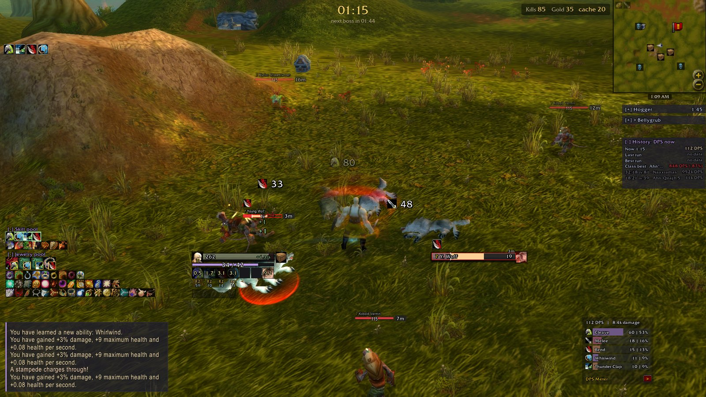
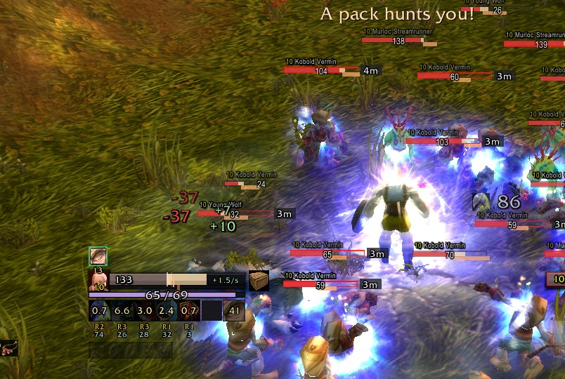
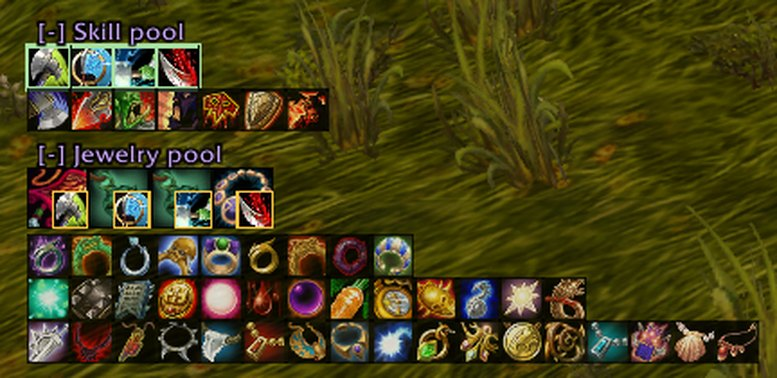
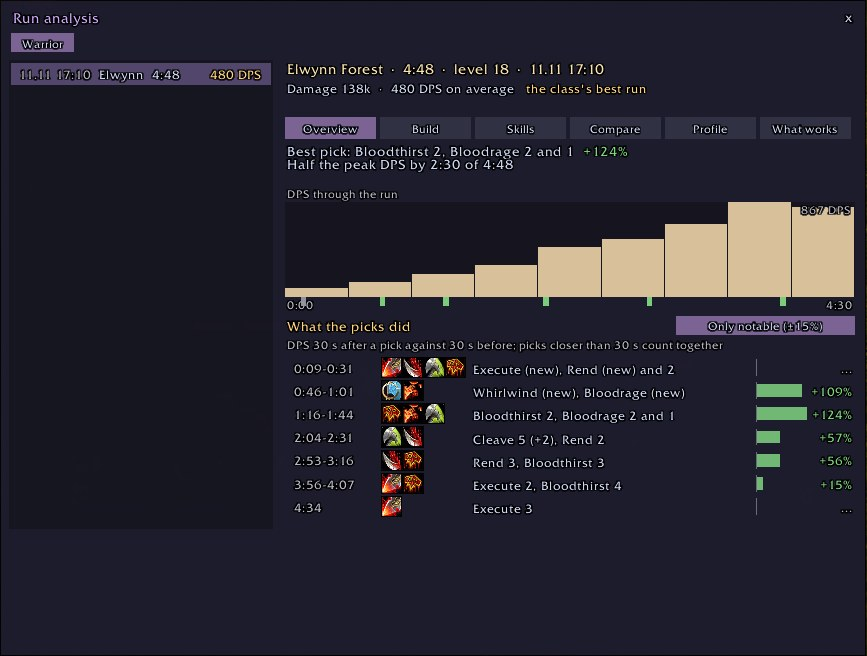
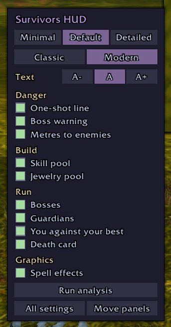
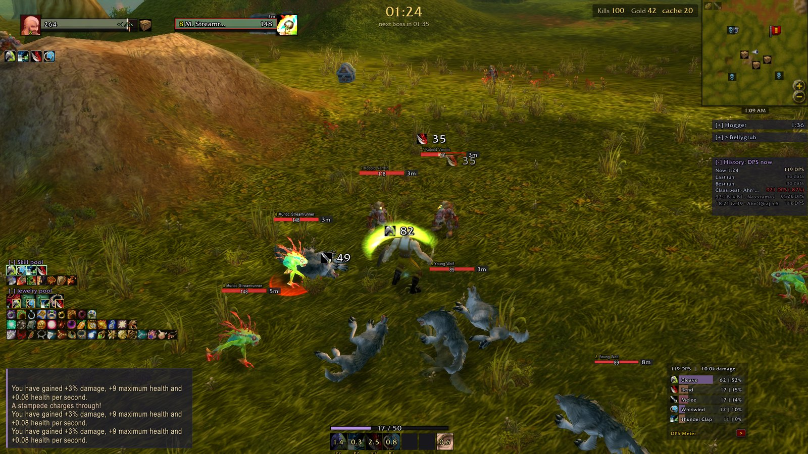
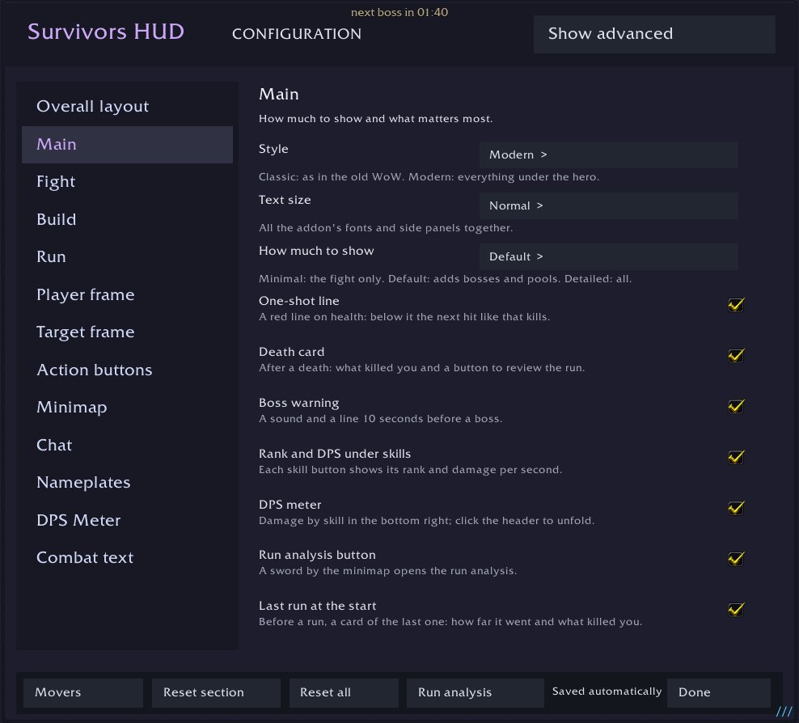

# Survivors HUD

**See what will kill you. See what can still drop. See why the run ended.**

An interface for Azeroth Survivors · Windows and browser · English and Russian · free
An unofficial edit of [nfUI](https://github.com/nfmous/nfui_AZSRV) by nfmous

[Русский](README.ru.md) · [What's new](../CHANGELOG.md) · [Feedback and bugs](../../../issues/new/choose)

## Install in a minute

1. Download [`update-nfUI.bat`](../../../releases/latest) and put it in the game folder, next to `benilla-config`.
2. Run it. It installs the addon and updates it the same way later; your settings stay.
3. Start the game and pick a style: **Classic** or **Modern**.

<b>Install by hand, without the bat file</b>

1. Download `nfUI-survivors-edit.zip` from the [latest release](../../../releases/latest).
2. Close the game. If `benilla-config/AddOns` already has an `nfUI` folder, delete it.
3. Unzip the archive into `benilla-config/AddOns`, so that you get `benilla-config/AddOns/nfUI`.
4. Start the game and enable **Survivors HUD** in the addon list.

Updating works the same way: delete the old folder, unzip the new one. Your settings are kept elsewhere and stay.

**Browser version:** Options → AddOns → Install AddOns → [`nfUI-survivors-edit.zip`](../web/nfUI-survivors-edit.zip). No unpacking needed.

## What it gives you

| See the danger | Know your build | Learn from runs |
|---|---|---|
|  |  |  |
| Health as a number and a red line at the hit that kills. A countdown to every boss and guardian, metres to enemies. | What you have and what can still drop, with your skills' legendaries pictured as in the Codex. | What killed you, DPS against your best run, and what each pick gave. |

One menu sets it up: the gear by the minimap.

<b>Everything on the screen</b>

| Part | What it shows |
|---|---|
| Hero frame | Health as a number, regeneration per second, shield as a frame, a chest when gold covers a cache. A red line at the biggest hit of the last minute; below it the bar flashes |
| Skill buttons | Cooldowns, rank and DPS under each. The tooltip adds damage per second, share and damage this run |
| Bosses and guardians | A countdown to each boss; when each guardian wakes and its health |
| You against your best | DPS now against your last and best run with this class at the same second |
| Skill and jewelry pools | What you have in a row of its own, below what can still drop. A click on an icon marks it banished |
| Enemy bars | Level in the classic WoW colours, health, metres, a red edge on close enemies. Elites, guardians and bosses look different |
| Damage numbers | Your hits above the target with the skill's icon; damage and healing on you in a column above your health |
| DPS meter | Damage by skill; in co-op the whole party |
| Death card | One-shot, burst, swarmed or worn down; health and shield over the last seconds |
| Minimap | Guardians (blue asleep, orange awake) and caches |
| Co-op | Allies' loadouts under their frames, a skull on a downed ally until they are raised |

<b>Styles, modes and text size</b>

**Style.** Classic puts large hero and target frames in the top left and the buttons at the bottom centre, as in the old WoW. Modern keeps everything compact under the hero. If you moved anything, going back to Modern brings your own layout back.

**How much to show.** Minimal: the fight only. Default: adds bosses, guardians, pools and the comparison with your best run. Detailed: everything, including hero stats and the DPS graph. Any switch can be turned on or off over the mode; it is marked as changed.

**Text size.** A−, A or A+ changes all the addon's fonts and side panels at once.

<b>Settings, commands and keys</b>

- **Gear by the minimap:** click for the quick menu, Shift+click for all settings, right click to move panels.
- **Sword beside it:** run analysis.
- `/nfui` all settings · `/nfui setup` first setup · `/nfui runs` run analysis · `/nfui death` the last death card · `/nfui export` run history as text.
- A key for the mode: Key Bindings → Survivors HUD.
- **Moving panels:** Movers in the settings; a right click on a panel gives exact sizes and a lock.

<b>Run analysis</b>

Keeps the last 20 runs of each class.

- **Overview:** the run in one line, DPS over the run against your best, picks marked on the graph with what they gave.
- **Build:** skills, jewelry and gear with ranks, talents.
- **Skills:** damage by skill.
- **Compare:** this run against the best here or the best of the class.
- **Profile:** the class over all runs: longest, strongest, where you play, what you pick most.
- **What works:** runs with each skill or item against runs without it.

<b>Questions</b>

**Is it safe?** It is an ordinary addon: it reads only what the game gives addons and draws on the screen. It has no network and no files.

**Will it slow the game?** It is light, and any panel can be switched off.

**How do I go back?** Delete the `benilla-config/AddOns/nfUI` folder.

**Something is in the wrong place.** `/nfui setup` or Reset all in the settings. Your run history stays.

## Feedback and bugs

Write in [Issues](../../../issues/new/choose): what does not work, what is unclear, what is missing. Add a screenshot to a bug.

---

Based on [nfUI](https://github.com/nfmous/nfui_AZSRV) by nfmous. An unofficial project, not affiliated with nfmous, the Azeroth Survivors developers or Blizzard Entertainment. World of Warcraft is a trademark of Blizzard Entertainment. Third-party notices: [`nfUI/Resources/licenses`](../nfUI/Resources/licenses). Colours after the [Catppuccin](https://catppuccin.com/) palette.
