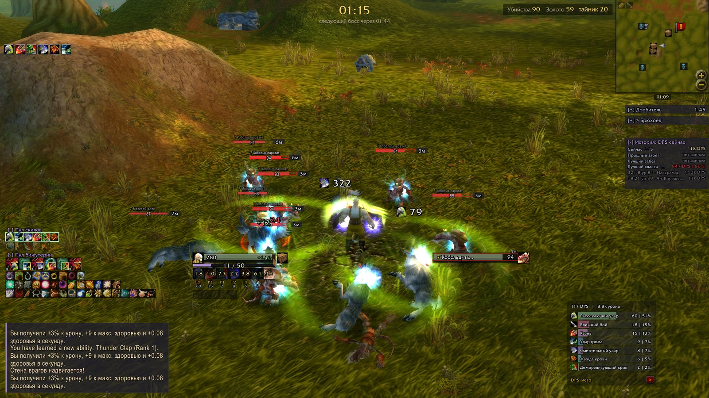
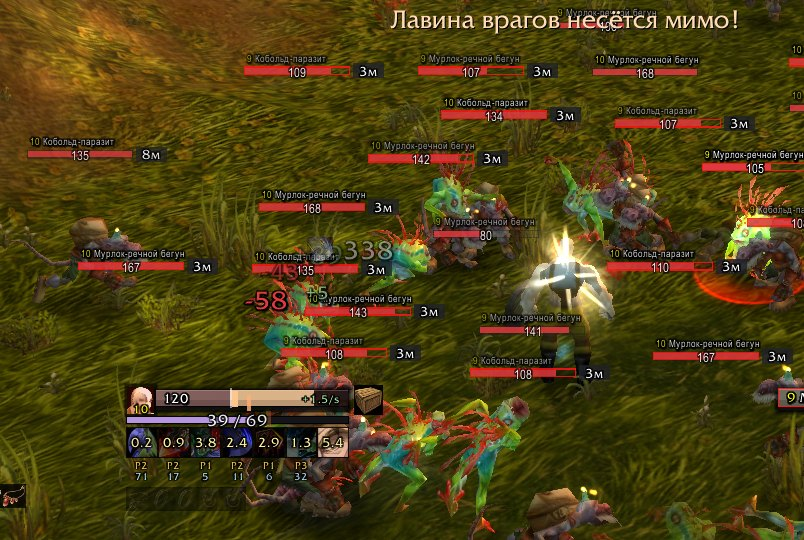
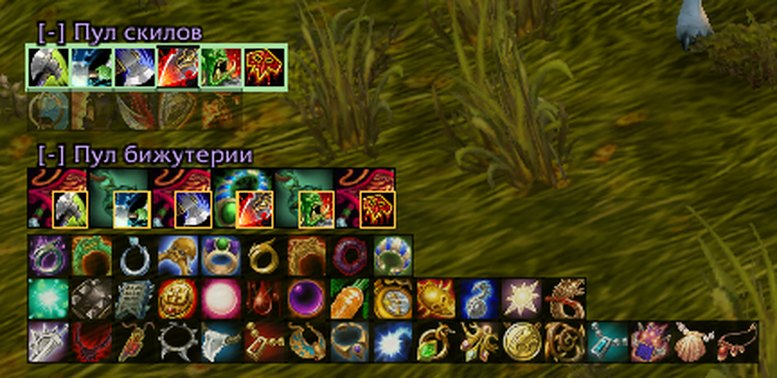
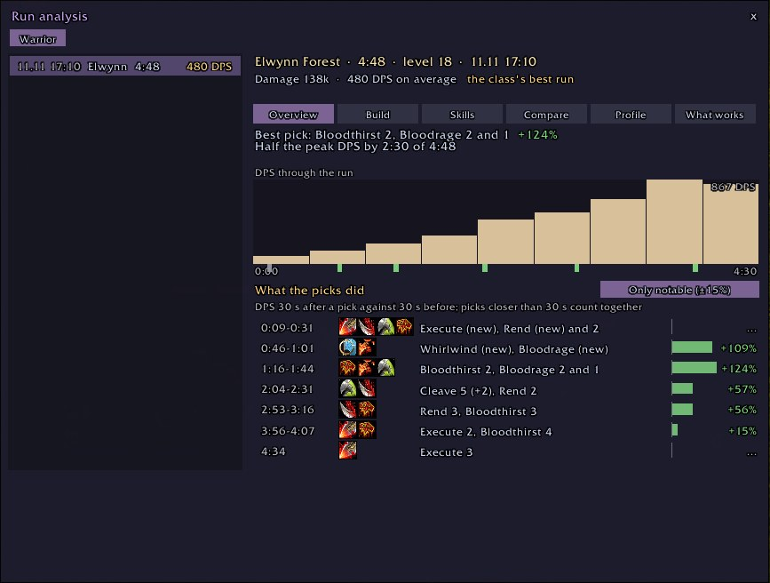
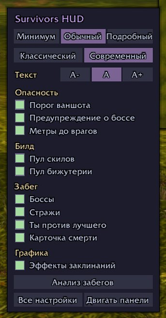
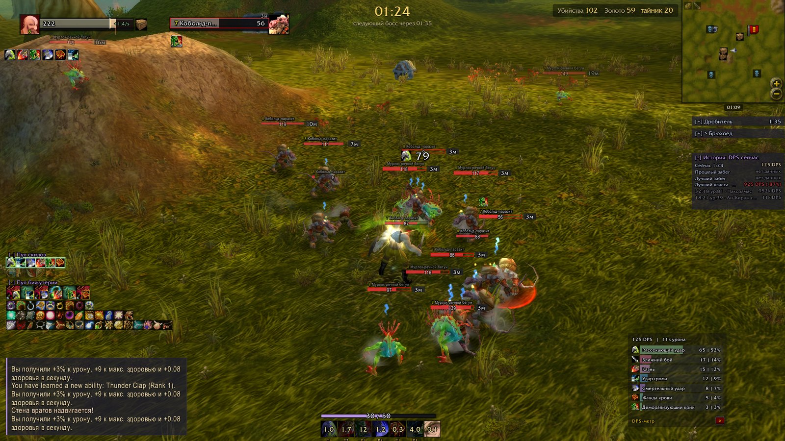
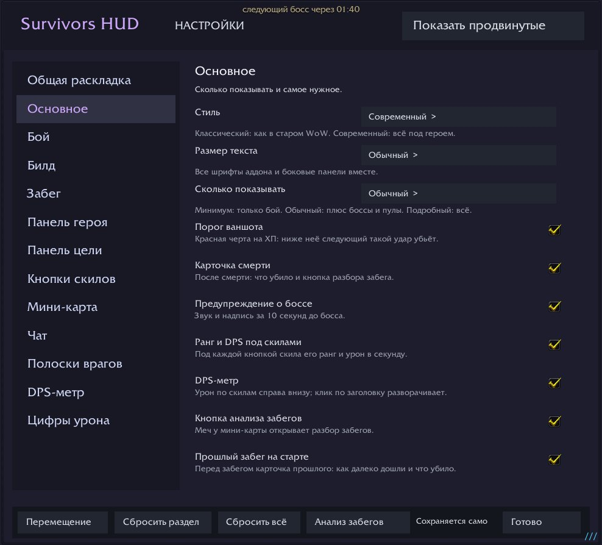

# Survivors HUD

**Видно, что убьёт. Видно, что выпадет. Видно, почему умер.**

Интерфейс для Azeroth Survivors · Windows и браузер · русский и английский · бесплатно
Неофициальная доработка [nfUI](https://github.com/nfmous/nfui_AZSRV) от nfmous

[English](README.md) · [Что нового](../CHANGELOG.md) · [Отзывы и ошибки](../../../issues/new/choose)

## Поставить за минуту

1. Скачайте [`update-nfUI.bat`](../../../releases/latest) и положите в папку игры, рядом с `benilla-config`.
2. Запустите его. Он ставит аддон и потом так же обновляет, настройки остаются.
3. Запустите игру и выберите стиль: **Классический** или **Современный**.

<b>Поставить вручную, без bat-файла</b>

1. Скачайте `nfUI-survivors-edit.zip` из [последнего релиза](../../../releases/latest).
2. Закройте игру. Если в `benilla-config/AddOns` уже есть папка `nfUI`, удалите её.
3. Распакуйте архив в `benilla-config/AddOns`, чтобы получилось `benilla-config/AddOns/nfUI`.
4. Запустите игру, в списке аддонов включите **Survivors HUD**.

Обновление так же: удалить старую папку, распаковать новую. Настройки хранятся отдельно и остаются.

**Браузерная версия:** Настройки → AddOns → Install AddOns → [`nfUI-survivors-edit.zip`](../web/nfUI-survivors-edit.zip). Распаковывать не нужно.

## Что он даёт

| Вижу опасность | Понимаю билд | Учусь на забегах |
|---|---|---|
|  |  |  |
| ХП числом и красная черта на ударе, который убьёт. Отсчёт до каждого босса и стража, метры до врагов. | Что уже взято и что ещё может выпасть, легендарки ваших скилов с картинками из «Кодекса». | Что убило, DPS против вашего лучшего забега и что дала каждая покупка. |

Настраивается одним меню: шестерёнка у мини-карты.

<b>Всё, что на экране</b>

| Часть | Что показывает |
|---|---|
| Панель героя | ХП числом, реген в секунду, щит рамкой, сундук, когда хватает золота. Красная черта: самый большой удар за минуту; ниже неё полоска мигает |
| Кнопки скилов | Перезарядка, под каждой ранг и DPS. В подсказке: урон в секунду, доля и урон за забег |
| Боссы и стражи | Отсчёт до каждого босса; когда проснётся страж и сколько у него ХП |
| Ты против лучшего | DPS сейчас против прошлого и лучшего забега этим классом в ту же секунду |
| Пул скилов и бижутерии | Взятое отдельным рядом, ниже то, что ещё может выпасть. Клик по значку отмечает его изгнанным |
| Полоски врагов | Уровень в цветах классического WoW, ХП, метры, красная рамка у ближних. Элитки, стражи и боссы различаются |
| Цифры урона | Ваши удары над целью со значком скила; урон и хил по вам колонкой над ХП |
| DPS-метр | Урон по скилам; в кооперативе вся группа |
| Карточка смерти | Ваншот, залп, толпа или сточили; ХП и щит за последние секунды |
| Мини-карта | Стражи (голубые спят, оранжевые проснулись) и сундуки |
| Кооператив | Снаряжение союзников под их рамками, череп на упавшем союзнике, пока его не поднимут |

<b>Стили, режимы и размер текста</b>

**Стиль.** Классический ставит крупные рамки героя и цели слева сверху и кнопки внизу по центру, как в старом WoW. Современный собирает всё компактно под героем. Если вы что-то двигали, при возврате к Современному вернётся ваша раскладка.

**Сколько показывать.** Минимум: только бой. Обычный: плюс боссы, стражи, пулы и сравнение с лучшим забегом. Подробный: всё, включая статы героя и график DPS. Любую галочку можно включить или выключить поверх режима, она отметится как изменённая.

**Размер текста.** A−, A или A+ меняет все шрифты аддона и боковые панели разом.

<b>Настройки, команды и клавиши</b>

- **Шестерёнка у мини-карты:** клик открывает быстрое меню, Shift+клик все настройки, правая кнопка двигает панели.
- **Меч рядом:** анализ забегов.
- `/nfui` все настройки · `/nfui setup` первая настройка · `/nfui runs` анализ забегов · `/nfui death` последняя карточка смерти · `/nfui export` история забегов текстом.
- Клавиша для режима: Key Bindings → Survivors HUD.
- **Двигать панели:** «Перемещение» в настройках; правая кнопка по панели даёт точные размеры и закрепление.

<b>Анализ забегов</b>

Хранит последние 20 забегов каждого класса.

- **Обзор:** забег одной фразой, DPS по ходу забега против лучшего, покупки на графике с тем, что они дали.
- **Билд:** скилы, бижутерия и снаряжение с рангами, таланты.
- **Скилы:** урон по скилам.
- **Сравнение:** этот забег против лучшего здесь или лучшего у класса.
- **Профиль:** класс за все забеги: дольше, сильнее, где играли, что берёте чаще.
- **Что работает:** забеги с каждым скилом или предметом против забегов без него.

<b>Вопросы</b>

**Это безопасно?** Это обычный аддон: он читает только то, что игра даёт аддонам, и рисует на экране. Сети и файлов у него нет.

**Не тормозит?** Он лёгкий, а любую панель можно выключить.

**Как вернуть как было?** Удалите папку `benilla-config/AddOns/nfUI`.

**Что-то стоит не так.** `/nfui setup` или «Сбросить всё» в настройках. История забегов сохраняется.

## Отзывы и ошибки

Пишите в [Issues](../../../issues/new/choose): что не работает, что непонятно, чего не хватает. К ошибке приложите скриншот.

---

На основе [nfUI](https://github.com/nfmous/nfui_AZSRV) от nfmous. Неофициальный проект, не связан с nfmous, разработчиками Azeroth Survivors и Blizzard Entertainment. World of Warcraft — товарный знак Blizzard Entertainment. Уведомления о стороннем коде: [`nfUI/Resources/licenses`](../nfUI/Resources/licenses). Цвета по палитре [Catppuccin](https://catppuccin.com/).
